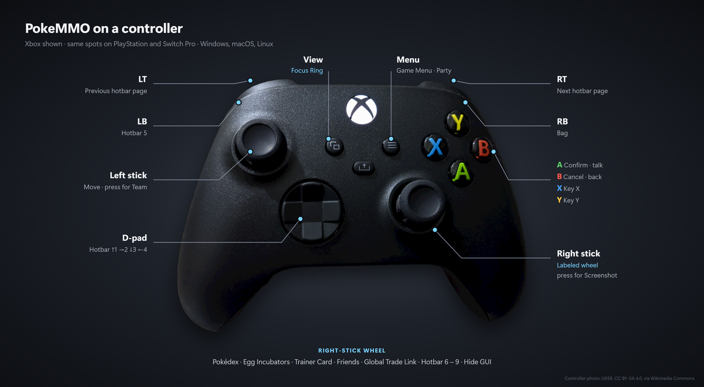
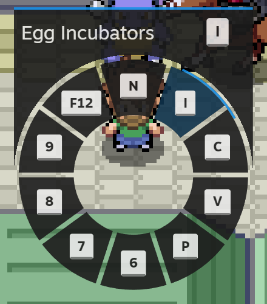

# PokeMMO Controller Layout


Play [PokeMMO](https://pokemmo.com) on Windows, macOS or Linux (Steam Deck too)
with an **Xbox, PlayStation or Switch Pro** controller, using the game's **own
controller support**. All 9 hotbar slots, Bag, Party, Pokédex,
GTL, Friends, Team and the rest are on the controller, plus a labeled
right-stick wheel so you can see what each direction does.

**At a glance**

- **Works with:** Xbox, PlayStation and Switch Pro pads on Windows, macOS, Linux
  and Steam Deck (Desktop Mode). Which of these were played on real hardware is
  listed honestly under [Tested with](#tested-with).
- **Install in about a minute, one command:** nothing to install first, no
  administrator rights, and uninstall puts every file back byte for byte.
- **Allowed:** PokeMMO lets you remap while one input does one thing. This layout
  keeps to that: 1 input = 1 action, no turbo, no macros ([details](#is-this-allowed)).
- **Change any button yourself:** a remap screen in your browser, no extra software.



Playing on another pad? The same spots, with that pad's own button names (a
drawn outline, not a photo, so the shapes are approximate; on Switch Pro the
printed A confirms, as on a Switch):
[PlayStation](docs/button-map-playstation.svg) ·
[Switch Pro](docs/button-map-switch.svg). Or print them:
`python tools/pads.py playstation` (also `switch`, `xbox`; add
`--switch-positional` to see that setting).

## Contents

- [Quick start](#quick-start)
- [Controls](#controls)
- [How do I… with a controller](#how-do-i-with-a-controller)
- [Is this allowed?](#is-this-allowed)
- [Troubleshooting](#troubleshooting)
- [How it works](#how-it-works)
- [Compared with other setups](#compared-with-other-setups)
- [Roadmap](#roadmap)
- [Tested with](#tested-with)

## Quick start

One command. Nothing to install first (no Python, no git).

1. Close PokeMMO. Leave Steam open: the installer closes it and opens it again
   when it has to (never while a Steam game is running).
2. Paste the line for your system:

   **Windows** (PowerShell):
   ```powershell
   irm https://raw.githubusercontent.com/jordanallenlewis/pokemmo-controller/main/install.ps1 | iex
   ```
   **macOS / Linux / Steam Deck** (Terminal; on Deck use Desktop Mode):
   ```sh
   curl -fsSL https://raw.githubusercontent.com/jordanallenlewis/pokemmo-controller/main/install.sh | sh
   ```
3. Launch **PokeMMO from your Steam library** (the installer adds it). No Steam?
   You still get every bind; only the wheel needs Steam.

The installer finds PokeMMO and Steam by itself (Windows install folder, macOS
app, Linux zip, Flatpak, Snap). If you don't have Python 3.9+, it fetches a
private copy for that one run and deletes it afterwards. It prints the version
it installed. It needs no administrator rights; on macOS and Linux, don't use `sudo`.

### Change what a button does

Open the remap screen in your browser: pick the input for each action, move the
wheel slices around, press **Apply**. Close PokeMMO first.

```powershell
& ([scriptblock]::Create((irm https://raw.githubusercontent.com/jordanallenlewis/pokemmo-controller/main/install.ps1))) -Ui
```
```sh
curl -fsSL https://raw.githubusercontent.com/jordanallenlewis/pokemmo-controller/main/install.sh | sh -s -- --ui
```

The screen runs on your computer only (nothing is sent anywhere) and needs
nothing installed. It writes your layout with the same installer, so the backup
and the uninstall above work the same, and a later update keeps your layout. You
can export a layout to a file, share it and import it; `--layout FILE` installs a
file and `--reset-layout` goes back to the default.

To open the screen later with one short command, add `--install-ui` (`-InstallUi`
on Windows) to the install. It keeps a small copy next to PokeMMO's settings
(`pokemmo-controller/remap.cmd` on Windows, `remap.sh` on macOS and Linux; the
installer prints the exact command), and uninstall removes it. It needs Python 3.9
or newer to be on the computer; without it, use the commands above.


PokeMMO allows remapping while one input does one thing, so that is built in: an
input holds one action, a wheel slice presses one key when you let go, and a
layout with a repeat, a sequence, a delay or one input doing two things is
refused, also in a file edited by hand.

### Update

Run the same command again. It updates whatever an earlier version wrote and
tells you what happened:

- `Installed v1.1.0`: first install.
- `Updated from v1.0.0 to v1.1.0`: an older version was there.
- `Already up to date (v1.1.0). Nothing changed.`: Steam isn't even restarted.

Your choices (`--switch-positional`, extra `--name` pads) are remembered.

### Uninstall

```powershell
& ([scriptblock]::Create((irm https://raw.githubusercontent.com/jordanallenlewis/pokemmo-controller/main/install.ps1))) -Uninstall
```
```sh
curl -fsSL https://raw.githubusercontent.com/jordanallenlewis/pokemmo-controller/main/install.sh | sh -s -- --uninstall
```

If nothing else changed a file since the install, it gets its original bytes
back. If PokeMMO or Steam changed it since (they rewrite their settings when
they close), only this project's parts come out: your other settings, and
controller binds you made by hand, stay. The Steam shortcut, wheel layouts,
backups and the install record are removed; nothing is left behind.

### Options

`-NoWheel` / `--no-wheel` (binds only, no Steam), `-SwitchPositional` /
`--switch-positional`, `-Ui` / `--ui` and `-InstallUi` / `--install-ui` (the remap
screen, above), and `-DryRun` / `--dry-run` (list the files that would change and
change nothing; PokeMMO may stay open). From a clone, `python tools/setup.py` does the same thing
(`--help` lists everything, `--version` prints the version). Rarely needed:

- `--pokemmo FOLDER` and `--steam FOLDER`: point at PokeMMO's data folder (the one
  holding `config/main.properties`) or Steam's folder when the installer cannot
  find them, for example a game library on another drive.
- `--name "Pad name"`: also bind a pad that PokeMMO shows under another name.
- `--switch-labels`: Nintendo pads confirm on the printed **A** (the default; undoes `--switch-positional`).
- `--no-browser`: with `--ui`, print the address instead of opening a browser.

## Controls

| Xbox | PlayStation | Switch Pro | Action |
|---|---|---|---|
| Left stick | Left stick | Left stick | Move |
| A | ✕ Cross | A | Confirm / talk |
| B | ○ Circle | B | Cancel / back |
| X / Y | □ Square / △ Triangle | X / Y | The game's Key X / Key Y |
| **View** (⧉) | **Create / Share** | **−** | **Focus Ring:** select anything on screen |
| Menu (≡) | Options | + | Game Menu (Party, Settings…) |
| RB | R1 | R | Bag |
| LB | L1 | L | Hotbar 5 |
| D-pad ↑ → ↓ ← | D-pad | D-pad | Hotbar 1 / 2 / 3 / 4 |
| RT / LT | R2 / L2 | ZR / ZL | Next / previous hotbar page |
| Right stick | Right stick | Right stick | **Wheel** (see below) |
| L3 (press left stick) | L3 | Press left stick | Team |
| R3 (press right stick) | R3 | Press right stick | Screenshot |

On a Switch Pro controller, the printed **A** confirms and **B** cancels, the
same as on a Switch. Prefer the Xbox positions (bottom button confirms)? Run
`apply_native.py --switch-positional`.

### The Focus Ring

Tap **View** and a highlight jumps onto the hotbar, your party or an open
window. Move it with the stick, press **A** to use what's highlighted, and press
**B** or **View** to leave. Every hotbar slot on every page can be reached this way,
not only the ones with their own button.

### The wheel

Tilt the right stick to open the wheel in the middle of the screen. Point at a
slice (its name shows above the wheel) and let go to use it. Let go in the
center to cancel.

| In game | Slices, clockwise from the top |
|---|---|
|  |  |

Each slice shows the key it presses (N = Pokédex, I = Egg Incubators,
C = Trainer Card, V = Friends, P = Global Trade Link, 6-9 = Hotbar 6-9,
F12 = Hide GUI) and sends exactly one key press when you let go.

## How do I… with a controller

| I want to… | Do this |
|---|---|
| Use any hotbar item (bike, rod, Sweet Scent…) | D-pad / LB for slots 1-5, wheel for 6-9, or **View** → pick → **A** |
| Switch hotbar page | RT / LT |
| Open my party / reorder it | Menu → Party, pick a Pokémon with the stick, **A** for its options |
| Open the bag / give an item | RB, pick the item, **A** → Give |
| Open the GTL | Wheel → Global Trade Link |
| Check the Pokédex / trainer card | Wheel → Pokédex / Trainer Card |
| Hatch eggs | Wheel → Egg Incubators |
| Type in chat or GTL search | Steam on-screen keyboard: **Steam button + X** (when launched from Steam), or a keyboard |
| Join a PvP queue, drag Pokémon in the PC | Still needs a mouse, see [Roadmap](#roadmap) |

## Is this allowed?

PokeMMO allows remapping as long as **one input from you produces no more than
one input to the game**, with no turbo, no sequences and no cursor jumps
([macro policy](https://support.pokemmo.com/knowledgebase/article/macroing-faq),
[setting up a controller](https://support.pokemmo.com/knowledgebase/article/setting-up-a-controller)).

This layout:
- uses **PokeMMO's own controller binds** for every button: the same thing you
  get by binding by hand in Settings → Controls;
- passes buttons through Steam **unchanged**;
- gives each wheel slice **one key press** on release;
- has **no turbo, no macros, no chained inputs**.

PokeMMO's support page also says it "cannot guarantee every remap software will
be accepted". Steam Input is the setup PokeMMO's own
[Steam Deck guide](https://support.pokemmo.com/knowledgebase/article/steam-deck-setup)
uses. Don't want any Steam involvement? Skip `install_wheel.py`; you lose only the wheel.

## Troubleshooting

**Controller not detected / buttons do nothing**
- Start PokeMMO once with the controller connected, close it, then run
  `apply_native.py` again. It reads PokeMMO's log and adds the name your pad
  reported, so third-party pads (8BitDo, PowerA…) are covered too.
- Settings → Control → *Enable Controller Support* must be ticked (`apply_native.py` does this).
- Close DS4Windows, DSX, reWASD, Xpadder and similar tools. Two remappers fighting is the most common cause.
- Bluetooth: unpair and pair again, or try a USB cable before launching.
- The game names each controller. With Steam Input on, PokeMMO sees
  `#SettingsController_SteamController`, and the binds are written for that name too.
  Still nothing? Copy the name PokeMMO shows in Settings → Controls and run
  `apply_native.py --name "That Name"`.

**The remap screen**
- *The browser did not open*: the address is printed in the terminal
  (`http://127.0.0.1:…`); copy it into any browser. To print it without trying
  to open one, add `--no-browser` (`sh -s -- --ui --no-browser`, or
  `python tools/setup.py --ui --no-browser` from a clone). The page only answers
  on your own computer and only with the key in that address.
- *"Page not found" or "forbidden"*: you opened an old address. Each run prints a
  new one; close the old tab and use the new address.
- *Apply says PokeMMO is open*: close the game, then press **Apply** again.
- *It says an input swapped*: an input can do only one thing, so picking one that
  another action used gives that action your old input. That is the 1 input = 1 action
  rule, not a bug.
- *A layout file is refused*: the message names the line. Files with repeats,
  sequences, delays or extra fields are refused on purpose.
- Nothing is sent anywhere. **Quit** stops it, and so does closing the terminal.

**No wheel**
- Launch PokeMMO **from the Steam library**, not the desktop shortcut.
- Steam → Settings → Controller: Steam Input must be on for your pad type
  (Xbox is off by default; PlayStation and Switch are on).

**A button fires twice**
- Another remapper is running, or a Steam layout other than this one is active
  for PokeMMO (Steam → PokeMMO → Controller Layout).

**Settings went back to default**
- PokeMMO was open during install. Close it and run the install command again.
  The installer stops if PokeMMO is open.

**The installer stops with a message**
- *A Steam game is running*: close the game; the installer won't restart Steam under it.
- *… is read-only*: make that file writable again (Properties → untick Read-only), then rerun.
  Nothing was changed.
- *Could not download*: check your connection and rerun. Nothing was changed.
- *Running scripts is disabled*: you ran a downloaded `install.ps1` file. Use the
  `irm … | iex` line instead (the execution policy doesn't apply to it), or
  `powershell -ExecutionPolicy Bypass -File install.ps1`.
- Stopped it halfway (Ctrl-C, closed the window)? Every file is either fully
  updated or untouched. Run the command again to finish, or uninstall.

**Undo**
- The uninstall command above reverts only what the installer changed. Other PokeMMO
  settings you changed since then are kept.

## How it works

- `tools/apply_native.py` writes the binds into PokeMMO's
  `config/main.properties`, key `client.controls.controller_input_maps_gdx_2`:
  ```
  Xbox One S Controller;KEY_A,BUTTON,0;KEY_B,BUTTON,1;KEY_RING_FOCUS,BUTTON,4;KEY_UP,AXIS,1,false;…|Xbox 360 Controller;…
  ```
  One entry per controller name; buttons and axes are SDL GameController
  numbers (table in the script). Action names include `KEY_HOTBAR_1`-`9`,
  `KEY_RING_FOCUS`, `KEY_GAMEMENU`, `KEY_INVENTORY`, `KEY_MONSTERDEX`,
  `KEY_TRAINER`, `KEY_FRIENDS_LIST`, `KEY_TEAM`, `KEY_TRADE_LINK`,
  `KEY_INCUBATOR`, `KEY_SCREENSHOT`, `KEY_HIDE_GUI`, `KEY_NEXT`, `KEY_PREVIOUS`.
- PokeMMO reads pads through SDL3, which numbers buttons by **position**
  (bottom, right, left, top…), so one map fits Xbox, PlayStation and Switch Pro.
  The map is filed under each controller's name, so the script writes it for
  every name SDL3 gives these pads, plus any pad PokeMMO logged on your machine.
  Maps you made by hand for other pads are kept.
- `tools/platforms.py` finds PokeMMO and Steam: the install folder on Windows,
  `~/Library/Application Support/com.pokeemu.macos/pokemmo-client-live` on
  macOS, `~/.var/app/com.pokemmo.PokeMMO/data/pokemmo-client-live` for Flatpak
  (paths from PokeMMO's [launcher source](https://github.com/PokeMMO/pokemmo-launcher)).
- `install.ps1` / `install.sh` download the project to a temp folder, use your
  Python 3.9+ or a private one from [uv](https://github.com/astral-sh/uv), run
  `tools/setup.py` (binds, then wheel, closing and restarting Steam around it)
  and delete the temp folder.
- `tools/install_wheel.py` builds a Steam Input layout for each controller type
  (Xbox One/Series, Xbox 360, DualSense, DualShock 4, Switch Pro and Steam Deck,
  in `steam/`), adds a
  "PokeMMO" non-Steam shortcut and sets the keyboard keys the wheel presses.
  Edit `WHEEL` in the script to change the slices (slot 0 is the center and stays empty; position, size and opacity are in `build_layout`).
- Every file touched is backed up once as `*.bak-pokemmo-controller`, and every
  write is atomic (a temp file renamed into place), so an interrupted run never
  leaves half a file. `config/pokemmo-controller.json` next to `main.properties`
  records the installed version and a hash of each file written; that is how an
  update knows what an older version wrote and how uninstall can restore files
  byte for byte. Uninstall deletes the backups and the record.
- `tests/` runs install → rerun → update → uninstall round trips in throwaway
  folders and compares every byte; CI runs them on Windows, macOS and Linux.

## Compared with other setups

| | This project | PokeMMO defaults | [pokemmo-port](https://github.com/lowlevel-1989/pokemmo-port) | [SteamInputDB layout](https://www.steaminputdb.com/config/3690044714) | Xpadder / JoyToKey guides |
|---|---|---|---|---|---|
| Platform | Windows, macOS, Linux, Deck | All | Linux handhelds | Steam | Windows |
| Xbox, PlayStation, Switch Pro | ✅ | bind by hand | ✅ | one pad type | ✅ |
| Uses the game's own binds | ✅ | ✅ | ❌ (keyboard emulation) | ❌ | ❌ |
| All 9 hotbar slots | ✅ | 4 | ✅ | ? | partly |
| Labeled wheel for menus | ✅ | ❌ | ❌ | ❌ | ❌ |
| Mouse cursor | ❌ (roadmap) | ❌ | ✅ | ✅ | ✅ |
| Installer + uninstaller | ✅ | n/a | ✅ | Steam UI | manual |
| Documented | ✅ | partly | ✅ | ❌ | old |

## Roadmap

- **Cursor mode** for mouse-only screens (PvP queue, PC box drag, some popups):
  a hold-to-aim right-stick mouse that still sends one click per press.
- A Steam Deck back-button variant (needs someone with a Deck to check it; the
  PlayStation and Switch Pro button maps are done, see above).
- Publish the wheel as a Steam community layout.

Ideas and controller reports welcome: [open an issue](https://github.com/jordanallenlewis/pokemmo-controller/issues).

## Tested with

- Xbox Wireless Controller (Bluetooth), Windows 11, 4K display, PokeMMO 2026-11
  client: played in game.
- Windows (PowerShell 5.1 and 7), Linux (Debian 13: sh, dash, bash, busybox) and
  macOS (CI): the one-line installers pass sandbox round trips (install, rerun,
  update from older versions, uninstall), with and without Python installed, and
  the original files come back byte for byte.
- PlayStation, Switch Pro and macOS: built from SDL3's controller names and
  PokeMMO's launcher source, but not yet played on real hardware.
  Please report results in an issue.

---

Not affiliated with or endorsed by PokeMMO. No game files or ROMs are included.
Code released under the [MIT License](LICENSE). The button map image uses
["Xbox Series Controller Carbon Black"](https://commons.wikimedia.org/wiki/File:Xbox_Series_Controller_Carbon_Black.jpg)
by UKER, [CC BY-SA 4.0](https://creativecommons.org/licenses/by-sa/4.0/), with the
background removed; `docs/button-map.*` and `docs/xbox-controller.webp` are CC BY-SA 4.0.
Xbox is a trademark of Microsoft.
