<h1 align="center">
<picture>
  <source media="(max-width: 700px) and (prefers-color-scheme: dark)" srcset="docs/img/hero-phone-dark.svg">
  <source media="(max-width: 700px)" srcset="docs/img/hero-phone-light.svg">
  <source media="(prefers-color-scheme: dark)" srcset="docs/img/hero-dark.svg">
  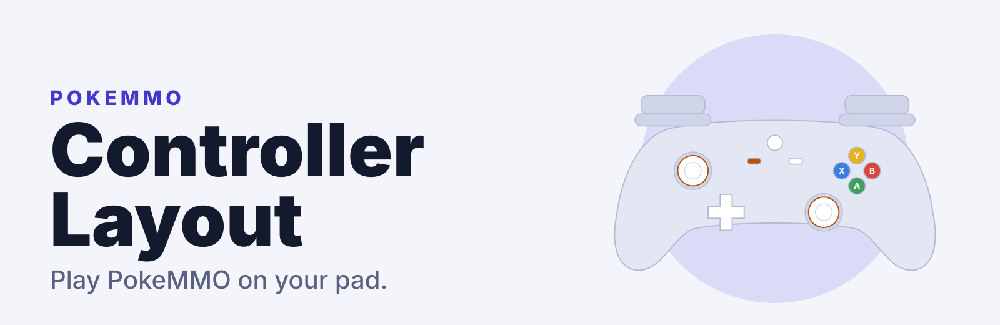
</picture>
</h1>

<p align="center">
<a href="#windows"><picture><source media="(prefers-color-scheme: dark)" srcset="docs/img/get-windows-dark.svg"></picture></a>
<a href="#macos"><picture><source media="(prefers-color-scheme: dark)" srcset="docs/img/get-mac-dark.svg"></picture></a>
<a href="#linux-and-steam-deck"><picture><source media="(prefers-color-scheme: dark)" srcset="docs/img/get-linux-dark.svg"></picture></a>
</p>

<p align="center"><em>PokeMMO Controller is an unofficial, fan-made tool, made by and for PokeMMO players. It is not made, endorsed or supported by the PokeMMO team.</em></p>

<p align="center">Free, MIT licensed · 1 input = 1 action (<a href="#is-this-allowed">is this allowed?</a>)</p>

Play [PokeMMO](https://pokemmo.com) on Windows, macOS or Linux (Steam Deck too)
with an **Xbox, PlayStation or Switch Pro** controller, using the game's **own
controller support**. All 9 hotbar slots, Bag, Party, Pokédex, GTL, Friends and
Team are on the controller, plus a labeled right-stick wheel so you can see what
each direction does.

<picture>
  <source media="(max-width: 700px) and (prefers-color-scheme: dark)" srcset="docs/img/strip-phone-dark.svg">
  <source media="(max-width: 700px)" srcset="docs/img/strip-phone-light.svg">
  <source media="(prefers-color-scheme: dark)" srcset="docs/img/strip-dark.svg">
  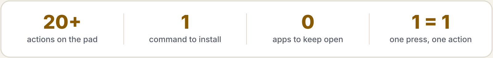
</picture>


More: [is this allowed?](#is-this-allowed) · [tested with](#tested-with)

## Quick start

One command. Nothing to install first (no Python, no git).

<picture>
  <source media="(max-width: 700px) and (prefers-color-scheme: dark)" srcset="docs/img/steps-phone-dark.svg">
  <source media="(max-width: 700px)" srcset="docs/img/steps-phone-light.svg">
  <source media="(prefers-color-scheme: dark)" srcset="docs/img/steps-dark.svg">
  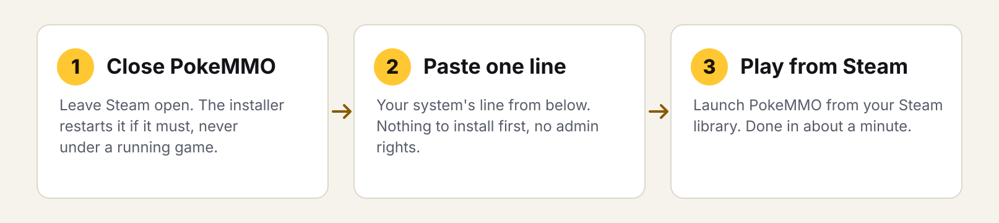
</picture>

1. Close PokeMMO. Leave Steam open: the installer closes it and opens it again
   when it has to (never while a Steam game is running).
2. Paste the line for your system (next section).
3. Launch **PokeMMO from your Steam library** (the installer adds it). No Steam?
   You still get every bind; only the wheel needs Steam.

### Windows

Open **PowerShell** (Start menu, type `powershell`) and paste:

```powershell
irm https://raw.githubusercontent.com/jordanallenlewis/pokemmo-controller/main/install.ps1 | iex
```

### macOS

Open **Terminal** and paste:

```sh
curl -fsSL https://raw.githubusercontent.com/jordanallenlewis/pokemmo-controller/main/install.sh | sh
```

### Linux and Steam Deck

Open a terminal (on a Deck, switch to **Desktop Mode** first) and paste the same line as on macOS:

```sh
curl -fsSL https://raw.githubusercontent.com/jordanallenlewis/pokemmo-controller/main/install.sh | sh
```

## Your button map

Pick your controller. Every map shows the default layout. These are drawn
outlines, not photos, so shapes are approximate.

<details open>
<summary><b>Xbox</b> (One, Series, 360)</summary>

<picture>
  <source media="(max-width: 700px) and (prefers-color-scheme: dark)" srcset="docs/img/map-xbox-phone-dark.svg">
  <source media="(max-width: 700px)" srcset="docs/img/map-xbox-phone-light.svg">
  <source media="(prefers-color-scheme: dark)" srcset="docs/img/map-xbox-dark.svg">
  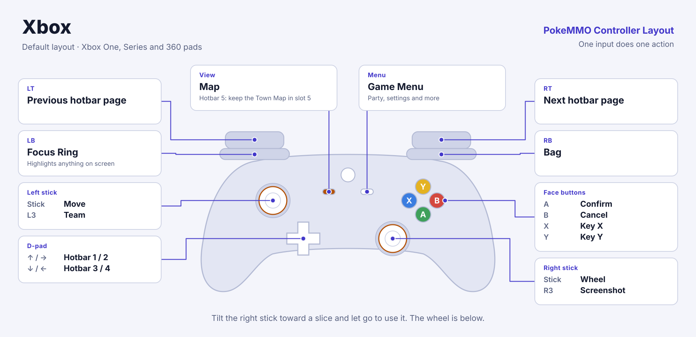
</picture>

</details>

<details>
<summary><b>PlayStation</b> (DualSense, DualShock 4)</summary>

<picture>
  <source media="(max-width: 700px) and (prefers-color-scheme: dark)" srcset="docs/img/map-playstation-phone-dark.svg">
  <source media="(max-width: 700px)" srcset="docs/img/map-playstation-phone-light.svg">
  <source media="(prefers-color-scheme: dark)" srcset="docs/img/map-playstation-dark.svg">
  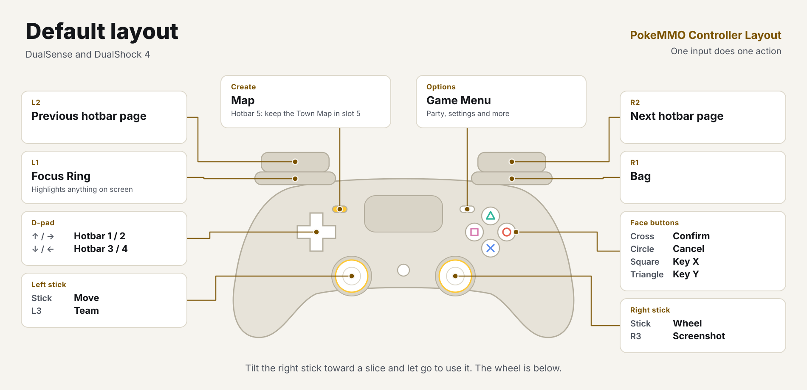
</picture>

</details>

<details>
<summary><b>Switch Pro</b> (the printed A confirms, as on a Switch)</summary>

<picture>
  <source media="(max-width: 700px) and (prefers-color-scheme: dark)" srcset="docs/img/map-switch-phone-dark.svg">
  <source media="(max-width: 700px)" srcset="docs/img/map-switch-phone-light.svg">
  <source media="(prefers-color-scheme: dark)" srcset="docs/img/map-switch-dark.svg">
  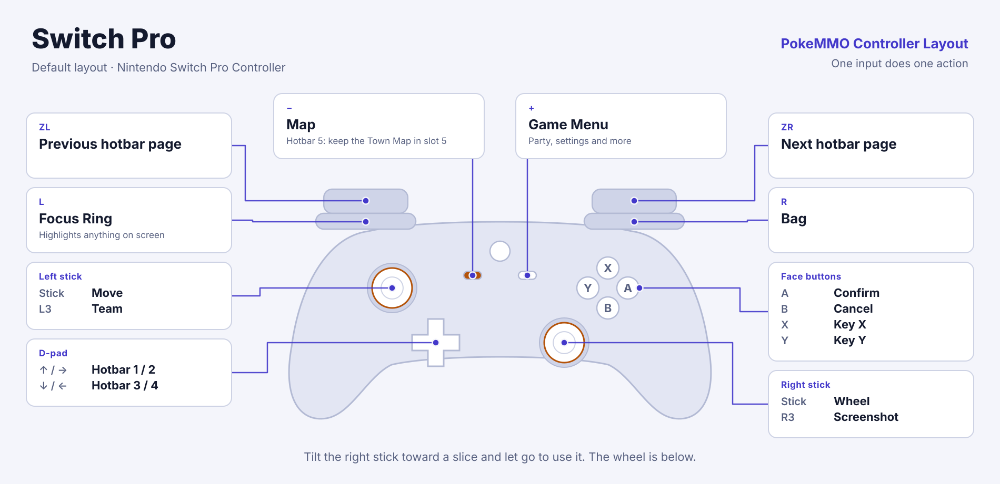
</picture>

</details>

<details>
<summary><b>Steam Deck</b> (Desktop Mode; Game Mode not yet tested on a Deck)</summary>

<picture>
  <source media="(max-width: 700px) and (prefers-color-scheme: dark)" srcset="docs/img/map-deck-phone-dark.svg">
  <source media="(max-width: 700px)" srcset="docs/img/map-deck-phone-light.svg">
  <source media="(prefers-color-scheme: dark)" srcset="docs/img/map-deck-dark.svg">
  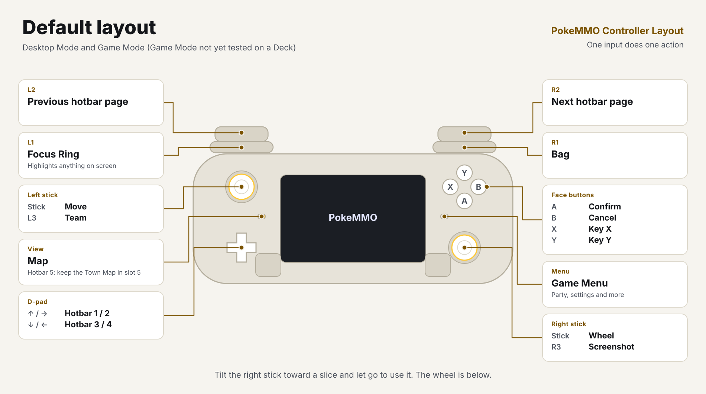
</picture>

</details>

<details>
<summary><b>Lenovo Legion Go S</b></summary>

<picture>
  <source media="(max-width: 700px) and (prefers-color-scheme: dark)" srcset="docs/img/map-legion-phone-dark.svg">
  <source media="(max-width: 700px)" srcset="docs/img/map-legion-phone-light.svg">
  <source media="(prefers-color-scheme: dark)" srcset="docs/img/map-legion-dark.svg">
  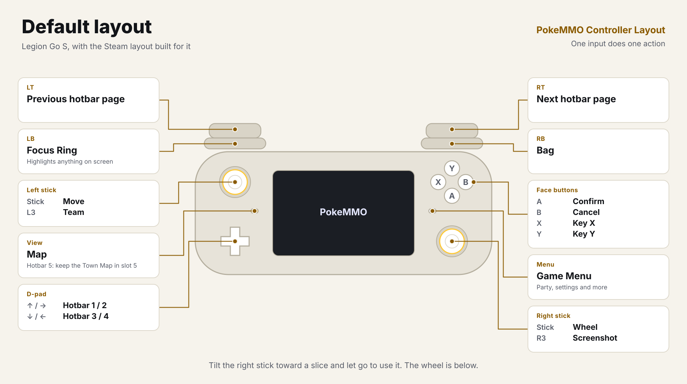
</picture>

</details>

Or print any of them in your terminal: `python tools/pads.py playstation` (also
`switch`, `xbox`; add `--switch-positional` to see that setting).

## The wheel

Tilt the right stick to open the wheel in the middle of the screen. Point at a
slice (its name shows above the wheel) and let go to use it. The **top slice
does nothing**, so a stray flick up presses nothing. Let go in the center to
cancel.

<picture>
  <source media="(prefers-color-scheme: dark)" srcset="docs/img/wheel-demo-dark.svg">
  
</picture>

| In game | Slices, clockwise from the empty top |
|---|---|
|  | <picture>
  <source media="(prefers-color-scheme: dark)" srcset="docs/img/wheel-dark.svg">
  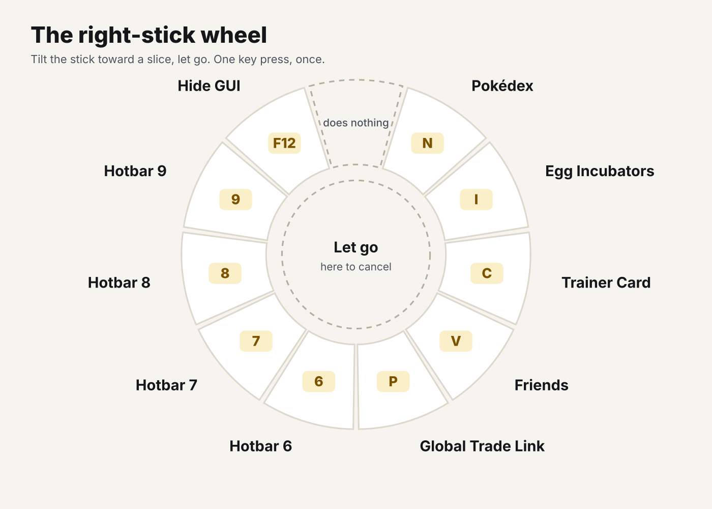
</picture> |

Each slice shows the key it presses (N = Pokédex, I = Egg Incubators,
C = Trainer Card, V = Friends, P = Global Trade Link, 6-9 = Hotbar 6-9,
F12 = Hide GUI) and sends exactly one key press when you let go.

## Install it once and forget it

<picture>
  <source media="(max-width: 700px) and (prefers-color-scheme: dark)" srcset="docs/img/features-phone-dark.svg">
  <source media="(max-width: 700px)" srcset="docs/img/features-phone-light.svg">
  <source media="(prefers-color-scheme: dark)" srcset="docs/img/features-dark.svg">
  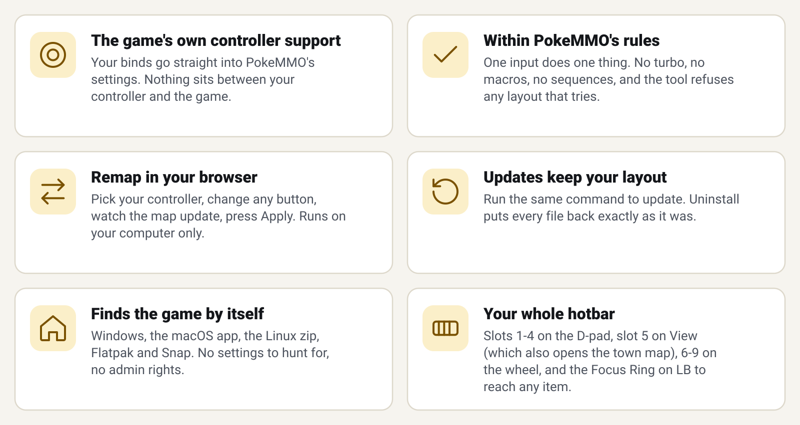
</picture>

## Contents

- [Quick start](#quick-start): [Windows](#windows), [macOS](#macos), [Linux and Steam Deck](#linux-and-steam-deck)
- [Your button map](#your-button-map) and [the wheel](#the-wheel)
- [Remap, update and uninstall](#remap-update-and-uninstall)
- [Controls](#controls)
- [How do I… with a controller](#how-do-i-with-a-controller)
- [Is this allowed?](#is-this-allowed)
- [Troubleshooting](#troubleshooting)
- [How it works](#how-it-works)
- [Compared with other setups](#compared-with-other-setups)
- [Roadmap](#roadmap)
- [Tested with](#tested-with)

## Remap, update and uninstall

### After the install

<details>
<summary>What the installer does</summary>

The installer finds PokeMMO and Steam by itself (Windows install folder, macOS
app, Linux zip, Flatpak, Snap). If you don't have Python 3.9+, it fetches a
private copy for that one run and deletes it afterwards. It prints the version
it installed. It needs no administrator rights; on macOS and Linux, don't use `sudo`.

</details>

### Change what a button does

Open the remap screen in your browser: pick your controller (Xbox, PlayStation
or Switch Pro, so the buttons carry their own names), pick the input for each
action, move the wheel slices around, and watch the button map below update.
Press **Apply**. Close PokeMMO first.

**Windows** (PowerShell):

```powershell
& ([scriptblock]::Create((irm https://raw.githubusercontent.com/jordanallenlewis/pokemmo-controller/main/install.ps1))) -Ui
```

**macOS and Linux** (Terminal):

```sh
curl -fsSL https://raw.githubusercontent.com/jordanallenlewis/pokemmo-controller/main/install.sh | sh -s -- --ui
```

The screen runs on your computer only (nothing is sent anywhere) and needs
nothing installed. It writes your layout with the same installer, so the backup
and the uninstall above work the same, and a later update keeps your layout.

<details>
<summary>Share a layout, or open the screen later with one short command</summary>

You can export a layout to a file, share it and import it; `--layout FILE` installs a
file and `--reset-layout` goes back to the default.

To open the screen later with one short command, add `--install-ui` (`-InstallUi`
on Windows) to the install. It keeps a small copy next to PokeMMO's settings
(`pokemmo-controller/remap.cmd` on Windows, `remap.sh` on macOS and Linux; the
installer prints the exact command), and uninstall removes it. It needs Python 3.9
or newer to be on the computer; without it, use the commands above.

</details>

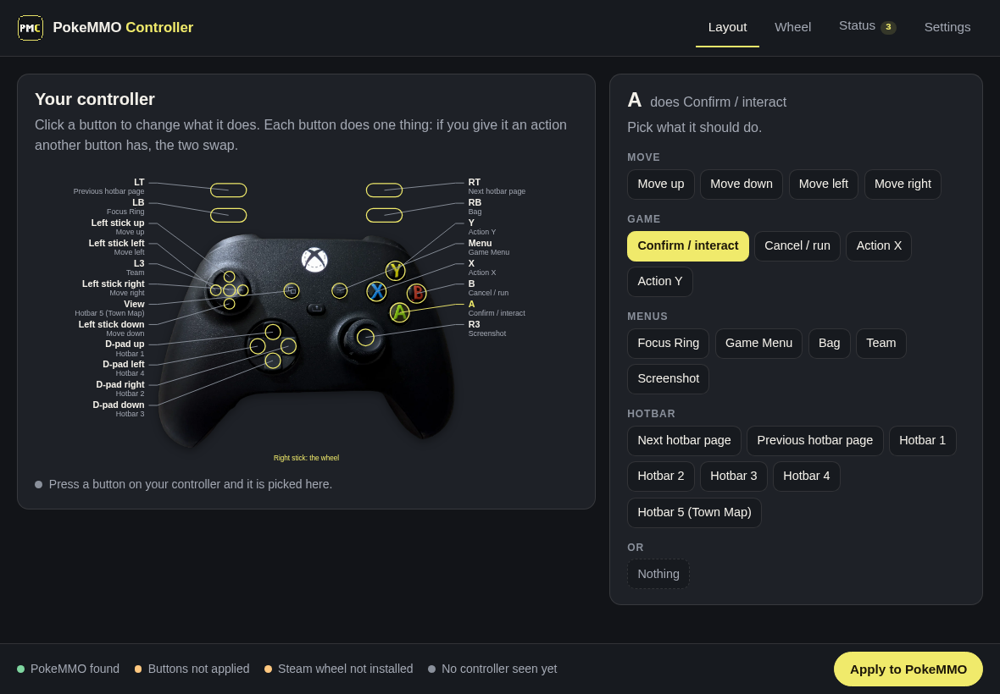

PokeMMO allows remapping while one input does one thing, so that is built in: an
input holds one action, a wheel slice presses one key when you let go, and a
layout with a repeat, a sequence, a delay or one input doing two things is
refused, also in a file edited by hand.

### Update

Run the same command again. It updates whatever an earlier version wrote and
tells you what happened:

- `Installed v1.2.0`: first install.
- `Updated from v1.1.0 to v1.2.0`: an older version was there.
- `Already up to date (v1.2.0). Nothing changed.`: Steam isn't even restarted.

Your choices (`--switch-positional`, extra `--name` pads) are remembered.

### Uninstall

```powershell
& ([scriptblock]::Create((irm https://raw.githubusercontent.com/jordanallenlewis/pokemmo-controller/main/install.ps1))) -Uninstall
```
```sh
curl -fsSL https://raw.githubusercontent.com/jordanallenlewis/pokemmo-controller/main/install.sh | sh -s -- --uninstall
```

If nothing else changed a file since the install, it gets its original bytes
back. If PokeMMO or Steam changed it since (they rewrite their settings when
they close), only this project's parts come out: your other settings, and
controller binds you made by hand, stay. The Steam shortcut, wheel layouts,
backups and the install record are removed; nothing is left behind.

### Options

`-NoWheel` / `--no-wheel` (binds only, no Steam), `-SwitchPositional` /
`--switch-positional`, `-Ui` / `--ui` and `-InstallUi` / `--install-ui` (the remap
screen, above), and `-DryRun` / `--dry-run` (list the files that would change and
change nothing; PokeMMO may stay open). From a clone, `python tools/setup.py` does the same thing
(`--help` lists everything, `--version` prints the version). Rarely needed:

- `--pokemmo FOLDER` and `--steam FOLDER`: point at PokeMMO's data folder (the one
  holding `config/main.properties`) or Steam's folder when the installer cannot
  find them, for example a game library on another drive.
- `--name "Pad name"`: also bind a pad that PokeMMO shows under another name.
- `--switch-labels`: Nintendo pads confirm on the printed **A** (the default; undoes `--switch-positional`).
- `--no-browser`: with `--ui`, print the address instead of opening a browser.
- `--tab`: with `--ui`, open a normal browser tab instead of the app window (the remap screen opens in its own window using Edge, Chrome, Chromium or Brave when one is installed, which Windows always has; closing that window ends it).
- `--follow`: keep the wheel sized while the game's resolution changes (see [Troubleshooting](#troubleshooting)).
  The installer already sets this up to run at login; `--no-follow` skips it (remembered) and `--follow-at-login` turns it back on.
- `--resolution 1920x1080`: size the wheel for the picture the game draws (see
  [The wheel is too big or too small](#troubleshooting)). Remembered; `--reset-resolution` goes back to the 4K size.

## Controls

| Xbox | PlayStation | Switch Pro | Action |
|---|---|---|---|
| Left stick | Left stick | Left stick | Move |
| A | ✕ Cross | A | Confirm / talk |
| B | ○ Circle | B | Cancel / back |
| X / Y | □ Square / △ Triangle | X / Y | The game's Key X / Key Y |
| **View** (⧉) | **Create / Share** | **−** | **Town Map** (Hotbar 5): opens the map, see [The map button](#the-map-button) |
| Menu (≡) | Options | + | Game Menu (Party, Settings…) |
| RB | R1 | R | Bag |
| LB | L1 | L | **Focus Ring:** select anything on screen |
| D-pad ↑ → ↓ ← | D-pad | D-pad | Hotbar 1 / 2 / 3 / 4 |
| RT / LT | R2 / L2 | ZR / ZL | Next / previous hotbar page |
| Right stick | Right stick | Right stick | **[Wheel](#the-wheel)** |
| L3 (press left stick) | L3 | Press left stick | Team |
| R3 (press right stick) | R3 | Press right stick | Screenshot |

On a Switch Pro controller, the printed **A** confirms and **B** cancels, the
same as on a Switch. Prefer the Xbox positions (bottom button confirms)? Run
`apply_native.py --switch-positional`.

### The map button

PokeMMO has no controller action called "map", so **View** presses **Hotbar 5**,
and the map opens from there. Do this once in game: open your Bag, find the
**Town Map** and put it in hotbar slot 5. The hotbar has pages (RT / LT turn
them), and each page has its own slot 5, so put the Town Map in slot 5 of every
page you use and View opens the map on all of them.

Not yet played on real hardware: if your Town Map will not go on the hotbar, tell
us in an issue, with your PokeMMO version.

### The Focus Ring

Tap **LB** and a highlight jumps onto the hotbar, your party or an open
window. Move it with the stick, press **A** to use what's highlighted, and press
**B** or **LB** to leave. Every hotbar slot on every page can be reached this way,
not only the ones with their own button.

## How do I… with a controller

| I want to… | Do this |
|---|---|
| Use any hotbar item (bike, rod, Sweet Scent…) | D-pad for slots 1-4, **View** for slot 5 (the Town Map), wheel for 6-9, or **LB** → pick → **A** |
| Switch hotbar page | RT / LT |
| Open my party / reorder it | Menu → Party, pick a Pokémon with the stick, **A** for its options |
| Open the bag / give an item | RB, pick the item, **A** → Give |
| Open the GTL | Wheel → Global Trade Link |
| Check the Pokédex / trainer card | Wheel → Pokédex / Trainer Card |
| Hatch eggs | Wheel → Egg Incubators |
| Type in chat or GTL search | Steam on-screen keyboard: **Steam button + X** (when launched from Steam), or a keyboard |
| Join a PvP queue, drag Pokémon in the PC | Still needs a mouse, see [Roadmap](#roadmap) |

## Is this allowed?

PokeMMO Controller is an unofficial, fan-made tool, made by and for PokeMMO players. It is not made, endorsed or supported by the PokeMMO team.

PokeMMO allows remapping as long as **one input from you produces no more than
one input to the game**, with no turbo, no sequences and no cursor jumps
([macro policy](https://support.pokemmo.com/knowledgebase/article/macroing-faq),
[setting up a controller](https://support.pokemmo.com/knowledgebase/article/setting-up-a-controller)).

This layout:
- uses **PokeMMO's own controller binds** for every button: the same thing you
  get by binding by hand in Settings → Controls;
- passes buttons through Steam **unchanged**;
- gives each wheel slice **one key press** on release;
- has **no turbo, no macros, no chained inputs**.

PokeMMO's support page also says it "cannot guarantee every remap software will
be accepted". Steam Input is the setup PokeMMO's own
[Steam Deck guide](https://support.pokemmo.com/knowledgebase/article/steam-deck-setup)
uses. Don't want any Steam involvement? Skip `install_wheel.py`; you lose only the wheel.

## Troubleshooting

Tap a heading to open it.

<details>
<summary><b>Controller not detected / buttons do nothing</b></summary>

- Start PokeMMO once with the controller connected, close it, then run
  `apply_native.py` again. It reads PokeMMO's log and adds the name your pad
  reported, so third-party pads (8BitDo, PowerA…) are covered too.
- Settings → Control → *Enable Controller Support* must be ticked (`apply_native.py` does this).
- Close DS4Windows, DSX, reWASD, Xpadder and similar tools. Two remappers fighting is the most common cause.
- Bluetooth: unpair and pair again, or try a USB cable before launching.
- The game names each controller. With Steam Input on, PokeMMO sees
  `#SettingsController_SteamController`, and the binds are written for that name too.
  Still nothing? Copy the name PokeMMO shows in Settings → Controls and run
  `apply_native.py --name "That Name"`.

</details>

<details>
<summary><b>The remap screen</b></summary>

- *The browser did not open*: the address is printed in the terminal
  (`http://127.0.0.1:…`); copy it into any browser. To print it without trying
  to open one, add `--no-browser` (`sh -s -- --ui --no-browser`, or
  `python tools/setup.py --ui --no-browser` from a clone). The page only answers
  on your own computer and only with the key in that address.
- *"Page not found" or "forbidden"*: you opened an old address. Each run prints a
  new one; close the old tab and use the new address.
- *Apply says PokeMMO is open*: close the game, then press **Apply** again.
- *The button names are wrong for my pad*: pick your controller at the top of the
  screen. It starts from a pad PokeMMO has seen on this computer.
  One layout fits all three pad families; only the names change.
- *It says an input swapped*: an input can do only one thing, so picking one that
  another action used gives that action your old input. That is the 1 input = 1 action
  rule, not a bug.
- *A layout file is refused*: the message names the line. Files with repeats,
  sequences, delays or extra fields are refused on purpose.
- Nothing is sent anywhere. **Quit** stops it, and so does closing the terminal.

</details>

<details>
<summary><b>The wheel is too big or too small</b></summary>

- Steam draws the wheel in screen pixels, so a size made for 4K looks huge at a
  lower resolution. The installer now measures your screen when it installs (the game
  window if PokeMMO is open, otherwise your main screen) and sizes the wheel to fit, so
  you do not need to do anything. If the game picture is not the size of your screen
  (windowed, or a lower resolution than the desktop), tell the installer the size: add `--resolution 1920x1080` after the install command (on Windows, the
  `& ([scriptblock]::Create(...))` form, then a space and `--resolution 1920x1080`; on
  macOS, Linux and Deck, `sh -s -- --resolution 1920x1080`), or run
  `python tools/setup.py --resolution 1920x1080` from a clone. Close PokeMMO first.
- **Changing the game's resolution while you play** (4K, then 1080p, then 1440p, back up,
  fullscreen, borderless or windowed, another monitor or display scaling): leave
  nothing: the installer sets up a small background helper that starts when you log in
  (a Startup entry on Windows, a LaunchAgent on macOS, an autostart entry on Linux and Steam Deck;
  it needs Python 3.9 or newer on the computer, and the installer says if that is missing;
  `--no-follow` skips it, uninstall removes it). You can also run
  `python tools/setup.py --follow` yourself (Ctrl+C stops it). It watches the size of the game picture and, once a new size
  has held for a moment, rewrites only the wheel layout files. A window that briefly reports
  0x0 or half a size mid-switch is ignored; a rapid string of changes ends on the last size
  that held. PokeMMO's 640x480 login window is skipped, a minimized game keeps the last
  size, and a change of under 4% in the wheel size (as a move between monitors of different
  display scale causes) writes nothing. It sends no input and never touches the game. Honest limit: Steam draws the wheel
  in screen pixels and reads the layout file; whether your Steam picks the new file up while
  PokeMMO is already running is not verified on real hardware. If the wheel keeps its old
  size after a change, restart PokeMMO from Steam once (the file is already right).
  With the helper off, the size is set when you install (and again each time you run the installer,
  unless you gave `--resolution`, which is kept), so run the command again after a change.
- The size follows the shorter side of the picture, so ultrawide (3440x1440), 4:3
  (1600x1200), 720p windows and 4K all fit, and it never goes above the 4K size.
  Windowed, fullscreen and borderless: use the size of the game's picture, not of your
  monitor. `--reset-resolution` returns to the 4K size.

</details>

<details>
<summary><b>No wheel</b></summary>

- Launch PokeMMO **from the Steam library**, not the desktop shortcut.
- Steam → Settings → Controller: Steam Input must be on for your pad type
  (Xbox is off by default; PlayStation and Switch are on).

</details>

<details>
<summary><b>A button fires twice</b></summary>

- Another remapper is running, or a Steam layout other than this one is active
  for PokeMMO (Steam → PokeMMO → Controller Layout).

</details>

<details>
<summary><b>Settings went back to default</b></summary>

- PokeMMO was open during install. Close it and run the install command again.
  The installer stops if PokeMMO is open.

</details>

<details>
<summary><b>The installer stops with a message</b></summary>

- *A Steam game is running*: close the game; the installer won't restart Steam under it.
- *… is read-only*: make that file writable again (Properties → untick Read-only), then rerun.
  Nothing was changed.
- *Could not download*: check your connection and rerun. Nothing was changed.
- *Running scripts is disabled*: you ran a downloaded `install.ps1` file. Use the
  `irm … | iex` line instead (the execution policy doesn't apply to it), or
  `powershell -ExecutionPolicy Bypass -File install.ps1`.
- Stopped it halfway (Ctrl-C, closed the window)? Every file is either fully
  updated or untouched. Run the command again to finish, or uninstall.

</details>

<details>
<summary><b>Undo</b></summary>

- The uninstall command above reverts only what the installer changed. Other PokeMMO
  settings you changed since then are kept.

</details>

## How it works

- `tools/apply_native.py` writes the binds into PokeMMO's
  `config/main.properties`, key `client.controls.controller_input_maps_gdx_2`:
  ```
  Xbox One S Controller;KEY_A,BUTTON,0;KEY_B,BUTTON,1;KEY_RING_FOCUS,BUTTON,4;KEY_UP,AXIS,1,false;…|Xbox 360 Controller;…
  ```
  One entry per controller name; buttons and axes are SDL GameController
  numbers (table in the script). Action names include `KEY_HOTBAR_1`-`9`,
  `KEY_RING_FOCUS`, `KEY_GAMEMENU`, `KEY_INVENTORY`, `KEY_MONSTERDEX`,
  `KEY_TRAINER`, `KEY_FRIENDS_LIST`, `KEY_TEAM`, `KEY_TRADE_LINK`,
  `KEY_INCUBATOR`, `KEY_SCREENSHOT`, `KEY_HIDE_GUI`, `KEY_NEXT`, `KEY_PREVIOUS`.
- PokeMMO reads pads through SDL3, which numbers buttons by **position**
  (bottom, right, left, top…), so one map fits Xbox, PlayStation and Switch Pro.
  The map is filed under each controller's name, so the script writes it for
  every name SDL3 gives these pads, plus any pad PokeMMO logged on your machine.
  Maps you made by hand for other pads are kept.
- `tools/platforms.py` finds PokeMMO and Steam: the install folder on Windows,
  `~/Library/Application Support/com.pokeemu.macos/pokemmo-client-live` on
  macOS, `~/.var/app/com.pokemmo.PokeMMO/data/pokemmo-client-live` for Flatpak
  (paths from PokeMMO's [launcher source](https://github.com/PokeMMO/pokemmo-launcher)).
- `install.ps1` / `install.sh` download the project to a temp folder, use your
  Python 3.9+ or a private one from [uv](https://github.com/astral-sh/uv), run
  `tools/setup.py` (binds, then wheel, closing and restarting Steam around it)
  and delete the temp folder.
- `tools/install_wheel.py` builds a Steam Input layout for each controller type
  (Xbox One/Series, Xbox 360, DualSense, DualShock 4, Switch Pro, Steam Deck and Lenovo Legion Go S,
  in `steam/`), adds a
  "PokeMMO" non-Steam shortcut and sets the keyboard keys the wheel presses.
  Edit `WHEEL` in the script to change the slices (slot 0 is the center and stays empty; position, size and opacity are in `build_layout`).
- Every file touched is backed up once as `*.bak-pokemmo-controller`, and every
  write is atomic (a temp file renamed into place), so an interrupted run never
  leaves half a file. `config/pokemmo-controller.json` next to `main.properties`
  records the installed version and a hash of each file written; that is how an
  update knows what an older version wrote and how uninstall can restore files
  byte for byte. Uninstall deletes the backups and the record.
- `tests/` runs install → rerun → update → uninstall round trips in throwaway
  folders and compares every byte; CI runs them on Windows, macOS and Linux.

## Compared with other setups

| | This project | PokeMMO defaults | [pokemmo-port](https://github.com/lowlevel-1989/pokemmo-port) | [SteamInputDB layout](https://www.steaminputdb.com/config/3690044714) | Xpadder / JoyToKey guides |
|---|---|---|---|---|---|
| Platform | Windows, macOS, Linux, Deck | All | Linux handhelds | Steam | Windows |
| Xbox, PlayStation, Switch Pro | ✅ | bind by hand | ✅ | one pad type | ✅ |
| Uses the game's own binds | ✅ | ✅ | ❌ (keyboard emulation) | ❌ | ❌ |
| All 9 hotbar slots | ✅ | 4 | ✅ | ? | partly |
| Labeled wheel for menus | ✅ | ❌ | ❌ | ❌ | ❌ |
| Mouse cursor | ❌ (roadmap) | ❌ | ✅ | ✅ | ✅ |
| Installer + uninstaller | ✅ | n/a | ✅ | Steam UI | manual |
| Documented | ✅ | partly | ✅ | ❌ | old |

## Roadmap

- **Cursor mode** for mouse-only screens (PvP queue, PC box drag, some popups):
  a hold-to-aim right-stick mouse that still sends one click per press.
- A Steam Deck back-button variant (needs someone with a Deck to check it; the
  PlayStation and Switch Pro button maps are done, see above).
- Publish the wheel as a Steam community layout.

Ideas and controller reports welcome: [open an issue](https://github.com/jordanallenlewis/pokemmo-controller/issues).

## Tested with

- Xbox Wireless Controller (Bluetooth), Windows 11, 4K display, PokeMMO 2026-11
  client: played in game.
- Windows (PowerShell 5.1 and 7), Linux (Debian 13: sh, dash, bash, busybox) and
  macOS (CI): the one-line installers pass sandbox round trips (install, rerun,
  update from older versions, uninstall), with and without Python installed, and
  the original files come back byte for byte.
- PlayStation, Switch Pro and macOS: built from SDL3's controller names and
  PokeMMO's launcher source, but not yet played on real hardware.
  Please report results in an issue.

---

No game files or ROMs are included.
Code released under the [MIT License](LICENSE). The pictures in `docs/img/` are original drawings made for this project (built by `docs/art/build.py`), also MIT.
Xbox, PlayStation, Nintendo Switch, Steam and Lenovo are trademarks of their owners; they are named only to say which pads work.
