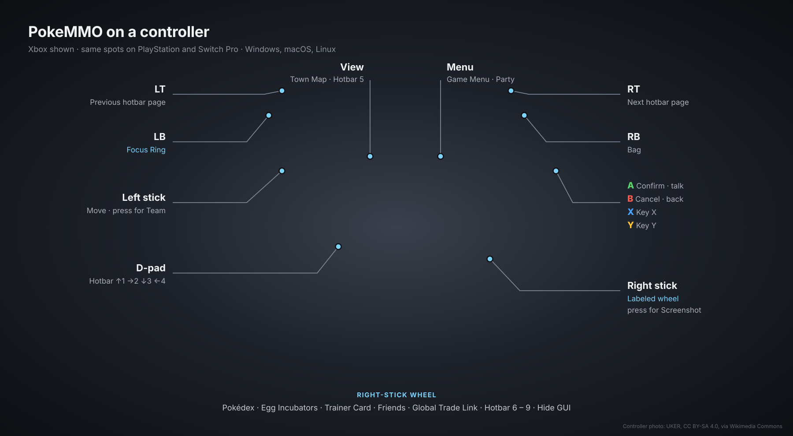
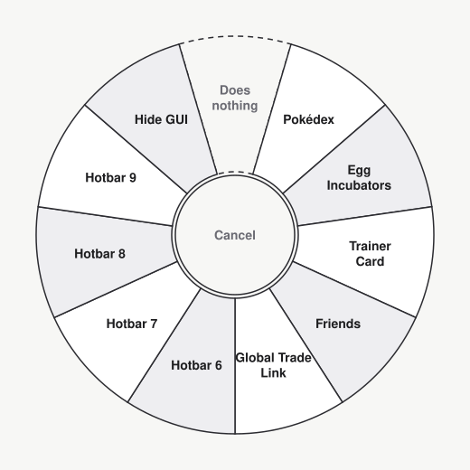

# PokeMMO Controller Layout


Play [PokeMMO](https://pokemmo.com) on Windows, macOS or Linux (Steam Deck too)
with an **Xbox, PlayStation or Switch Pro** controller, using the game's **own
controller support**. All 9 hotbar slots, Bag, Party, Pokédex,
GTL, Friends, Team and the rest are on the controller, plus a labeled
right-stick wheel so you can see what each direction does.



## Contents

- [Quick start](#quick-start)
- [Controls](#controls)
- [How do I… with a controller](#how-do-i-with-a-controller)
- [Is this allowed?](#is-this-allowed)
- [Troubleshooting](#troubleshooting)
- [How it works](#how-it-works)
- [Compared with other setups](#compared-with-other-setups)
- [Roadmap](#roadmap)

## Quick start

You need PokeMMO (started at least once), Python 3.9+ and, for the wheel, Steam.
Windows, macOS and Linux all work, including the Flatpak and Snap builds. The
scripts find PokeMMO and Steam by themselves.

1. Close PokeMMO **and** Steam. Both rewrite their config files when they exit.
2. Run:
   ```powershell
   git clone https://github.com/jordanallenlewis/pokemmo-controller
   cd pokemmo-controller
   py tools/apply_native.py      # PokeMMO's own controller binds
   py tools/install_wheel.py     # optional: right-stick wheel via Steam Input
   ```
   On macOS and Linux, use `python3` instead of `py`. On Steam Deck, switch to
   Desktop Mode and exit Steam first.
3. Start Steam, then launch **PokeMMO from your Steam library** (the installer
   adds it as a non-Steam game). Skipped the wheel? Start PokeMMO as usual.

Installed somewhere unusual? Add `--pokemmo <folder holding config/>` and
`--steam <Steam folder>`. To undo everything: `py tools/uninstall.py`.

## Controls

| Xbox | PlayStation | Switch Pro | Action |
|---|---|---|---|
| Left stick | Left stick | Left stick | Move |
| A | ✕ Cross | A | Confirm / talk |
| B | ○ Circle | B | Cancel / back |
| X / Y | □ Square / △ Triangle | X / Y | The game's Key X / Key Y |
| **View** (⧉) | **Create / Share** | **−** | **Focus Ring:** select anything on screen |
| Menu (≡) | Options | + | Game Menu (Party, Settings…) |
| RB | R1 | R | Bag |
| LB | L1 | L | Hotbar 5 |
| D-pad ↑ → ↓ ← | D-pad | D-pad | Hotbar 1 / 2 / 3 / 4 |
| RT / LT | R2 / L2 | ZR / ZL | Next / previous hotbar page |
| Right stick | Right stick | Right stick | **Wheel** (see below) |
| L3 (press left stick) | L3 | Press left stick | Team |
| R3 (press right stick) | R3 | Press right stick | Screenshot |

On a Switch Pro controller, the printed **A** confirms and **B** cancels, the
same as on a Switch. Prefer the Xbox positions (bottom button confirms)? Run
`apply_native.py --switch-positional`.

### The Focus Ring

Tap **View** and a highlight jumps onto the hotbar, your party or an open
window. Move it with the stick, press **A** to use what's highlighted, and press
**B** or **View** to leave. Every hotbar slot on every page can be reached this way,
not only the ones with their own button.

### The wheel

Tilt the right stick to open the wheel in the middle of the screen. Point at a
slice (its name shows above the wheel) and let go to use it. Let go in the
center to cancel.

| In game | Slices, clockwise from the top |
|---|---|
|  |  |

Each slice shows the key it presses (N = Pokédex, I = Egg Incubators,
C = Trainer Card, V = Friends, P = Global Trade Link, 6-9 = Hotbar 6-9,
F12 = Hide GUI) and sends exactly one key press when you let go.

## How do I… with a controller

| I want to… | Do this |
|---|---|
| Use any hotbar item (bike, rod, Sweet Scent…) | D-pad / LB for slots 1-5, wheel for 6-9, or **View** → pick → **A** |
| Switch hotbar page | RT / LT |
| Open my party / reorder it | Menu → Party, pick a Pokémon with the stick, **A** for its options |
| Open the bag / give an item | RB, pick the item, **A** → Give |
| Open the GTL | Wheel → Global Trade Link |
| Check the Pokédex / trainer card | Wheel → Pokédex / Trainer Card |
| Hatch eggs | Wheel → Egg Incubators |
| Type in chat or GTL search | Steam on-screen keyboard: **Steam button + X** (when launched from Steam), or a keyboard |
| Join a PvP queue, drag Pokémon in the PC | Still needs a mouse, see [Roadmap](#roadmap) |

## Is this allowed?

PokeMMO allows remapping as long as **one input from you produces no more than
one input to the game**, with no turbo, no sequences and no cursor jumps
([macro policy](https://support.pokemmo.com/knowledgebase/article/macroing-faq),
[setting up a controller](https://support.pokemmo.com/knowledgebase/article/setting-up-a-controller)).

This layout:
- uses **PokeMMO's own controller binds** for every button: the same thing you
  get by binding by hand in Settings → Controls;
- passes buttons through Steam **unchanged**;
- gives each wheel slice **one key press** on release;
- has **no turbo, no macros, no chained inputs**.

PokeMMO's support page also says it "cannot guarantee every remap software will
be accepted". Steam Input is the setup PokeMMO's own
[Steam Deck guide](https://support.pokemmo.com/knowledgebase/article/steam-deck-setup)
uses. Don't want any Steam involvement? Skip `install_wheel.py`; you lose only the wheel.

## Troubleshooting

**Controller not detected / buttons do nothing**
- Start PokeMMO once with the controller connected, close it, then run
  `apply_native.py` again. It reads PokeMMO's log and adds the name your pad
  reported, so third-party pads (8BitDo, PowerA…) are covered too.
- Settings → Control → *Enable Controller Support* must be ticked (`apply_native.py` does this).
- Close DS4Windows, DSX, reWASD, Xpadder and similar tools. Two remappers fighting is the most common cause.
- Bluetooth: unpair and pair again, or try a USB cable before launching.
- The game names each controller. With Steam Input on, PokeMMO sees
  `#SettingsController_SteamController`, and the binds are written for that name too.
  Still nothing? Copy the name PokeMMO shows in Settings → Controls and run
  `apply_native.py --name "That Name"`.

**No wheel**
- Launch PokeMMO **from the Steam library**, not the desktop shortcut.
- Steam → Settings → Controller: Steam Input must be on for your pad type
  (Xbox is off by default; PlayStation and Switch are on).

**A button fires twice**
- Another remapper is running, or a Steam layout other than this one is active
  for PokeMMO (Steam → PokeMMO → Controller Layout).

**Settings went back to default**
- PokeMMO was open while you ran a script. Close it and run the script again.
  The scripts refuse to run while PokeMMO or Steam is open.

**Undo**
- `py tools/uninstall.py` reverts only what these scripts changed. Other PokeMMO
  settings you changed since then are kept.

## How it works

- `tools/apply_native.py` writes the binds into PokeMMO's
  `config/main.properties`, key `client.controls.controller_input_maps_gdx_2`:
  ```
  Xbox One S Controller;KEY_A,BUTTON,0;KEY_B,BUTTON,1;KEY_RING_FOCUS,BUTTON,4;KEY_UP,AXIS,1,false;…|Xbox 360 Controller;…
  ```
  One entry per controller name; buttons and axes are SDL GameController
  numbers (table in the script). Action names include `KEY_HOTBAR_1`-`9`,
  `KEY_RING_FOCUS`, `KEY_GAMEMENU`, `KEY_INVENTORY`, `KEY_MONSTERDEX`,
  `KEY_TRAINER`, `KEY_FRIENDS_LIST`, `KEY_TEAM`, `KEY_TRADE_LINK`,
  `KEY_INCUBATOR`, `KEY_SCREENSHOT`, `KEY_HIDE_GUI`, `KEY_NEXT`, `KEY_PREVIOUS`.
- PokeMMO reads pads through SDL3, which numbers buttons by **position**
  (bottom, right, left, top…), so one map fits Xbox, PlayStation and Switch Pro.
  The map is filed under each controller's name, so the script writes it for
  every name SDL3 gives these pads, plus any pad PokeMMO logged on your machine.
  Maps you made by hand for other pads are kept.
- `tools/platforms.py` finds PokeMMO and Steam: the install folder on Windows,
  `~/Library/Application Support/com.pokeemu.macos/pokemmo-client-live` on
  macOS, `~/.var/app/com.pokemmo.PokeMMO/data/pokemmo-client-live` for Flatpak
  (paths from PokeMMO's [launcher source](https://github.com/PokeMMO/pokemmo-launcher)).
- `tools/install_wheel.py` builds a Steam Input layout for each controller type
  (Xbox One/Series, Xbox 360, DualSense, DualShock 4, Switch Pro and Steam Deck,
  in `steam/`), adds a
  "PokeMMO" non-Steam shortcut and sets the keyboard keys the wheel presses.
  Edit `WHEEL` in the script to change the slices (slot 0 is the center and stays empty; position, size and opacity are in `build_layout`).
- Every file touched is backed up once as `*.bak-pokemmo-controller`.

## Compared with other setups

| | This project | PokeMMO defaults | [pokemmo-port](https://github.com/lowlevel-1989/pokemmo-port) | [SteamInputDB layout](https://www.steaminputdb.com/config/3690044714) | Xpadder / JoyToKey guides |
|---|---|---|---|---|---|
| Platform | Windows, macOS, Linux, Deck | All | Linux handhelds | Steam | Windows |
| Xbox, PlayStation, Switch Pro | ✅ | bind by hand | ✅ | one pad type | ✅ |
| Uses the game's own binds | ✅ | ✅ | ❌ (keyboard emulation) | ❌ | ❌ |
| All 9 hotbar slots | ✅ | 4 | ✅ | ? | partly |
| Labeled wheel for menus | ✅ | ❌ | ❌ | ❌ | ❌ |
| Mouse cursor | ❌ (roadmap) | ❌ | ✅ | ✅ | ✅ |
| Installer + uninstaller | ✅ | n/a | ✅ | Steam UI | manual |
| Documented | ✅ | partly | ✅ | ❌ | old |

## Roadmap

- **Cursor mode** for mouse-only screens (PvP queue, PC box drag, some popups):
  a hold-to-aim right-stick mouse that still sends one click per press.
- PlayStation / Switch Pro button-map art and a Steam Deck back-button variant.
- Publish the wheel as a Steam community layout.

Ideas and controller reports welcome: [open an issue](https://github.com/jordanallenlewis/pokemmo-controller/issues).

## Tested with

- Xbox Wireless Controller (Bluetooth), Windows 11, 4K display, PokeMMO 2026-11
  client: played in game.
- Linux (Debian 13, Flatpak paths) and Windows: the install, wheel and uninstall
  scripts pass a sandbox round trip, and the original settings come back byte for byte.
- PlayStation, Switch Pro and macOS: built from SDL3's controller names and
  PokeMMO's launcher source, but not yet played on real hardware.
  Please report results in an issue.

---

Not affiliated with or endorsed by PokeMMO. No game files or ROMs are included.
Released under the [MIT License](LICENSE).
